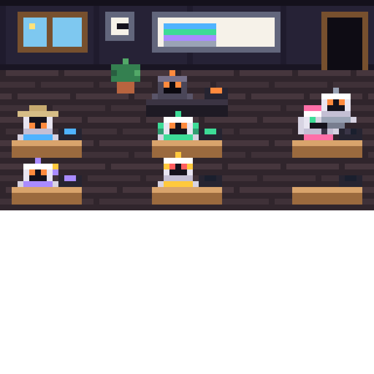

# bureau

Your session's agents as a small pixel-art office in a side pane. Claude sits at the lead's dark desk. Each subagent it calls walks in through the door, takes a desk in its trade's colour, and shows what it is doing right now: reading a file, searching the web, editing, running a command. When it finishes it cheers and walks out; one that fails looks sad for a while first.



> Adapted from [Le Bureau des agents](https://github.com/devlikemasta/bureau-des-agents) (commit `184daa8`) by VibesMoney, MIT licensed. See [LICENSE](LICENSE). Taken from it: the idea, the evening palette, the trades with their colours and first names, and the table that turns each tool call into an action. Changed here: instead of a separate web app that runs its own Claude sessions, the office lives in a Claude Code pane and shows the session you are in; the room and the cube robots are redrawn at a size a terminal can show (64 × 36 pixels, two per character cell), and the text is in English.

## What you see

- **The room**: a window whose sky follows the hour (day, sunset, night with stars), a clock, a board with a line per teammate at work that grows with every tool call, a plant, and a door that opens while someone walks through.
- **The lead**: Claude, the dark robot. It types while editing or running commands, reads while reading or searching, looks up while thinking, and raises its hand when it asks you something. Its laptop glows while it works.
- **The team**: up to six desks. A subagent's trade comes from its agent type (Explore is Research, a reviewer or tester is Code, a planner or analyst is Analysis, and so on), with the trade's accessory: an explorer's hat, headphones, a beret, a pencil, glasses. A seventh waits in the hallway for a desk to free up.
- **Under the room**: a line per agent with its bubble and how long it has been at it, and the session's counts (teammates, searches, pages, reads, edits, commands).

On the terminal the office is drawn with half-block characters; on the desktop it is an SVG, scaled to the pane.

## Commands

| Command | Does |
|---|---|
| `/bureau` | Open the office |
| `/bureau-auto` | Open it on its own the first time Claude calls a subagent (the default), or only with `/bureau` |

The office only watches this session's tool calls and subagents: it runs nothing, calls no model and costs nothing. `/clear` empties it.

## Install

```
/plugin install bureau@arhun-plugins
```
