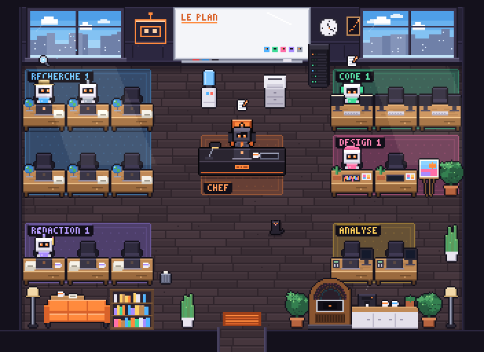
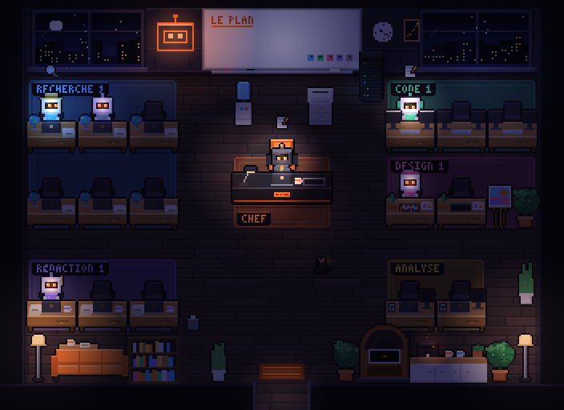

# bureau

[Le Bureau des agents](https://github.com/devlikemasta/bureau-des-agents) in a side pane of Claude Code: its pixel-art office, drawn by its own engine, playing the session you are in. Max, at the dark desk in the middle, is Claude. Each subagent Claude calls is hired for its trade: it comes in through the door, walks to a desk in its corner (Recherche, Code, Design, Rédaction, Analyse), works there with its screen lit and an icon for each action, brings its report to Max and walks out. The window follows the hour: day, evening, then night, when the lamps, the screens and the neon light the room.

| Day | Night |
|---|---|
|  |  |

> Adapted from [Le Bureau des agents](https://github.com/devlikemasta/bureau-des-agents) (commit `184daa8`) by VibesMoney, MIT licensed. See [LICENSE](LICENSE). Its engine (`src/engine/` and `shared/activity.ts`, `shared/protocol.ts`) is in `hooks/engine/`, unchanged except that it draws on `hooks/canvas.ts`, a small stand-in for the browser canvas (a hooks module has no DOM), and imports without the `.ts` suffix. New here: the events come from this session instead of a `claude -p` the Bureau starts itself, each frame is encoded as a PNG (`hooks/png.ts`) for the pane, and the agent list under the picture. The Bureau's interface, sounds, music, voice and interactions are not part of it.

## How the session maps to the office

| In the session | In the office |
|---|---|
| A turn starts | Max sits at his desk |
| A tool call (Read, WebSearch, Edit, Bash…) | An icon over the robot, its screen lit; the list shows the action ("Je lis app.ts") |
| `AskUserQuestion` | Max raises his hand |
| A subagent starts (the Agent tool) | A teammate is hired: the trade comes from the agent type (Explore is Recherche, a reviewer or tester is Code, a frontend agent is Design, a writer is Rédaction, a planner or analyst is Analyse, anything else a helper who stands) |
| The subagent ends | It brings its report to Max's desk and leaves; one that failed looks sad first |
| The turn ends, no one at work | Max walks back to the door; confetti when the turn went well |
| `/clear` | The office empties |

Under the picture, a line per agent with what it is doing and for how long, and the session's counts (agents, searches, pages, reads, writes, commands).

On the desktop the office is a picture in the pane, scaled to its width. On a terminal it is a picture where the terminal can show one (kitty, Ghostty), its description elsewhere.

## Commands

| Command | Does |
|---|---|
| `/bureau` | Open the office |
| `/bureau-auto` | Open it on its own the first time Claude calls a subagent (the default), or only with `/bureau` |

The office only watches this session: it runs nothing and calls no model. While the pane is open it draws about three frames a second when something moves (a frame takes about 50 ms), one a second otherwise; closed, it draws nothing.

## Install

```
/plugin install bureau@arhun-plugins
```
